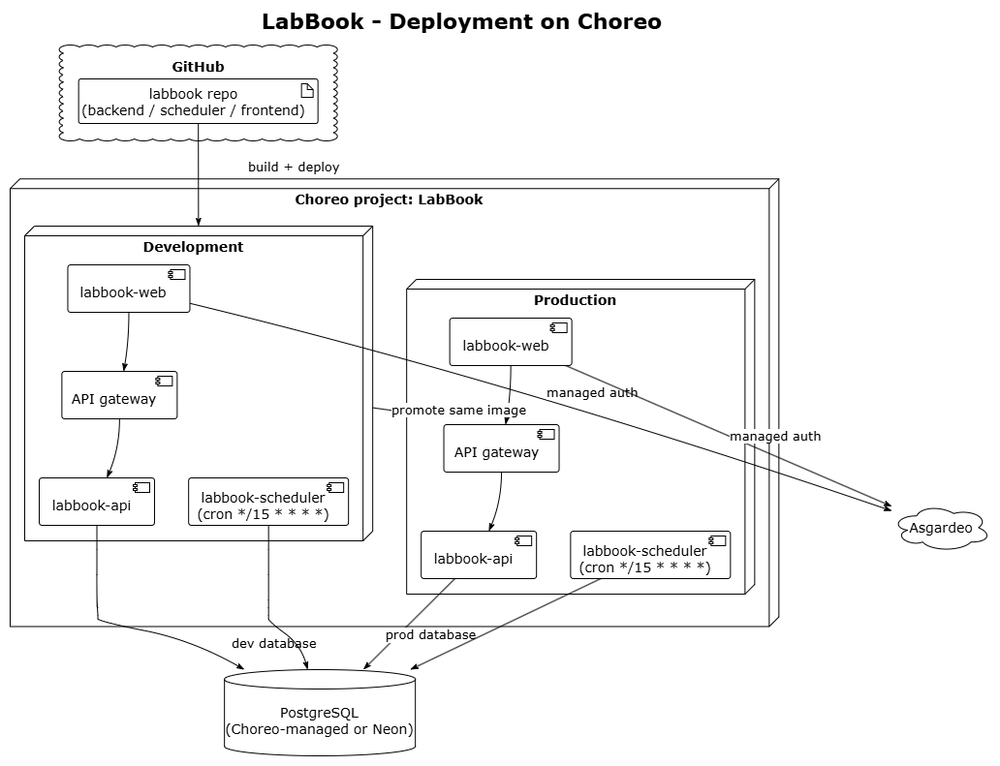

# Architecture

## Context

 · [source](diagrams/system-context.puml)

Students and lab admins use one web app. Asgardeo handles identity, Choreo hosts and secures everything, and GitHub is the build source.

## Components

| Component | Choreo type | Responsibility |
|---|---|---|
| `labbook-web` | Web Application (React SPA) | UI; signs in via Managed Authentication; calls the API through a Connection |
| `labbook-api` | Service (Ballerina, port 8080) | REST API, booking rules, role checks, database access |
| `labbook-scheduler` | Scheduled Task (Ballerina) | Every 15 minutes: expire stale pending bookings, complete finished approved ones |
| PostgreSQL 16 | Choreo-managed or Neon | Data and the no-overlap guarantee |

## Request flow

```
Browser -> labbook-web -> /choreo-apis/... -> Choreo gateway (token check, x-jwt-assertion)
        -> labbook-api -> PostgreSQL
```

 · [source](diagrams/seq-create-booking.puml)

## Deployment and environments

 · [source](diagrams/deployment-choreo.puml)

Development and Production run the same image, promoted between them. Each has its own configuration and its own database or schema.

## CI/CD

 · [source](diagrams/ci-cd-flow.puml)

## Configuration matrix

| Name | Component | Secret | Local value | Production source |
|---|---|---|---|---|
| `port` | api | no | 8080 | default |
| `dbHost`, `dbPort`, `dbName`, `dbUser` | api, scheduler | no | localhost, 5432, labbook, labbook | TODO(phase-8) |
| `dbPassword` | api, scheduler | **yes** | from `.env` | Choreo secret config |
| `dbSslMode` | api, scheduler | no | `disable` | `require` |
| `campusTimeZone` | api | no | `Asia/Colombo` | default |
| `adminEmails` | api | no | `admin@labbook.dev` | TODO(phase-8) |
| `jwtIssuer`, `jwtJwksUrl` | api | no | unused in dev mode | TODO(phase-8) |
| `devMode` | api | no | `true` | **always `false`** |
| `apiUrl`, `authMode` | web (`config.js`) | no | `/api`, `dev` | File mount, `choreo` |
