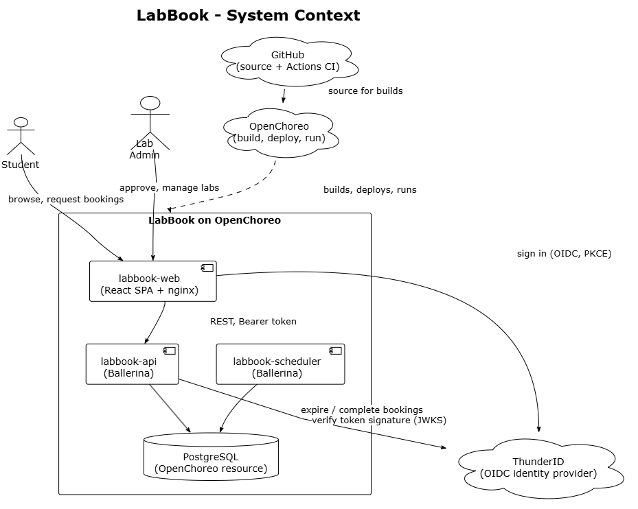
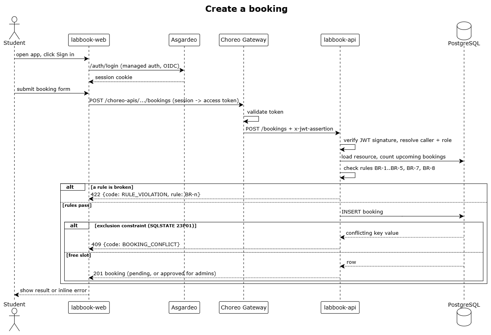
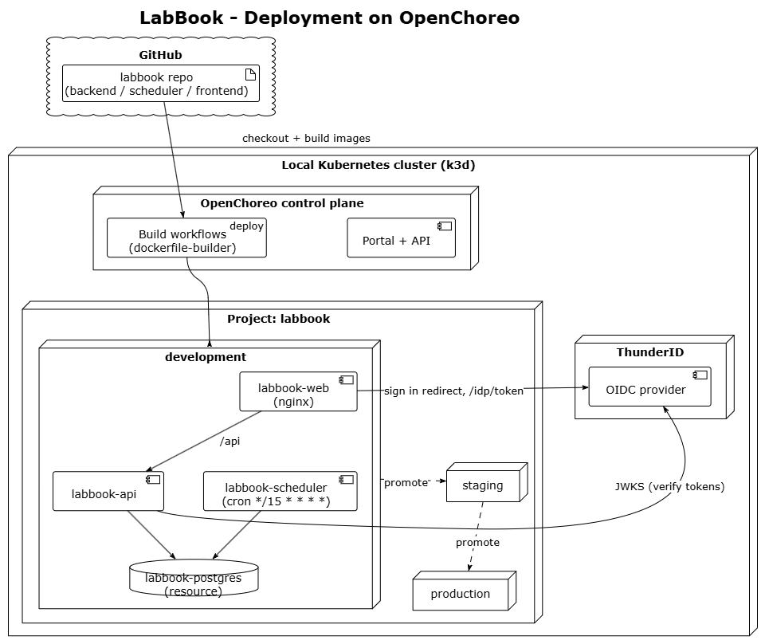
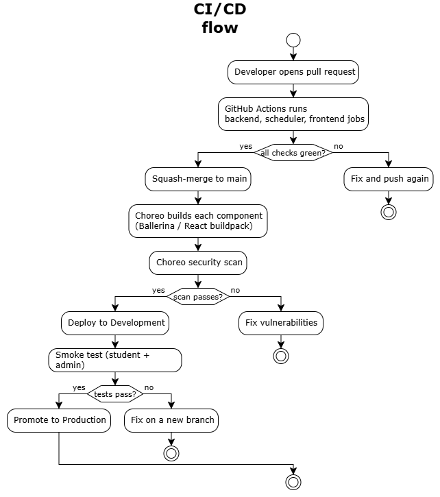

# Architecture

## Context

 · [source](diagrams/system-context.puml)

Students and lab admins use one web app. ThunderID handles sign-in, OpenChoreo builds and runs the components, and GitHub is the build source and CI.

## Components

| Component | OpenChoreo type | Built from | Responsibility |
|---|---|---|---|
| `labbook-web` | web-application | `frontend/Dockerfile` (Node build, then nginx) | UI; runs the OIDC sign-in; nginx proxies `/api/` to the API and `/idp/token` to ThunderID, and renders `/config.js` |
| `labbook-api` | service (port 8080) | `backend/Dockerfile` (Ballerina) | REST API, booking rules, token validation, role checks, database access |
| `labbook-scheduler` | scheduled task | `scheduler/Dockerfile` (Ballerina) | Every 15 minutes: expire stale pending bookings, complete finished approved ones |
| `labbook-postgres` | resource (`postgres` type) | OpenChoreo | PostgreSQL 16; the schema and demo data come from `db/migrations` at first start |

Each directory has a `workload.yaml` that declares its endpoints, environment variables and dependencies. The manifests are in [`deploy/openchoreo/`](../deploy/openchoreo/).

## Request flow

```
Browser -> labbook-web (nginx) -> /api/...  -> labbook-api -> PostgreSQL
        -> ThunderID (sign-in redirect)
        -> labbook-web /idp/token -> ThunderID (code exchange, server side)
```

 · [source](diagrams/seq-create-booking.puml)

The browser sends the access token to the API as `Authorization: Bearer`. The API verifies its signature with ThunderID's keys. Browser calls stay on one origin (the nginx proxy), so no CORS settings are needed.

## Deployment and environments

 · [source](diagrams/deployment-openchoreo.puml)

The project has development, staging and production environments from OpenChoreo's default deployment pipeline. The system was run end to end in development.

## CI/CD

 · [source](diagrams/ci-cd-flow.puml)

GitHub Actions runs the tests on every pull request. OpenChoreo's `dockerfile-builder` workflow then builds each component from the repository and deploys it to development.

## Configuration matrix

| Name | Component | Secret | Local value | OpenChoreo source |
|---|---|---|---|---|
| `port` | api | no | 8080 | default |
| `dbHost`, `dbPort`, `dbName`, `dbUser` | api, scheduler | no | localhost, 5432, labbook, labbook | Postgres resource outputs, bound in `workload.yaml` |
| `dbPassword` | api, scheduler | **yes** | from `.env` | Postgres resource output (generated) |
| `dbSslMode` | api, scheduler | no | `disable` | `disable` (in-cluster) |
| `campusTimeZone` | api | no | `Asia/Colombo` | default |
| `adminEmails` | api | no | `admin@labbook.dev` | `BAL_CONFIG_DATA` in `backend/workload.yaml` |
| `jwtIssuer`, `jwtJwksUrl` | api | no | unused in dev mode | ThunderID issuer and in-cluster JWKS URL |
| `jwtHeader` | api | no | `Authorization` | `Authorization` |
| `devMode` | api | no | `true` | **`false`** |
| `authMode`, `oidcAuthority`, `oidcClientId` | web (`/config.js`) | no | `dev` | `oidc`, ThunderID URL, `labbook-web` (nginx env vars) |
