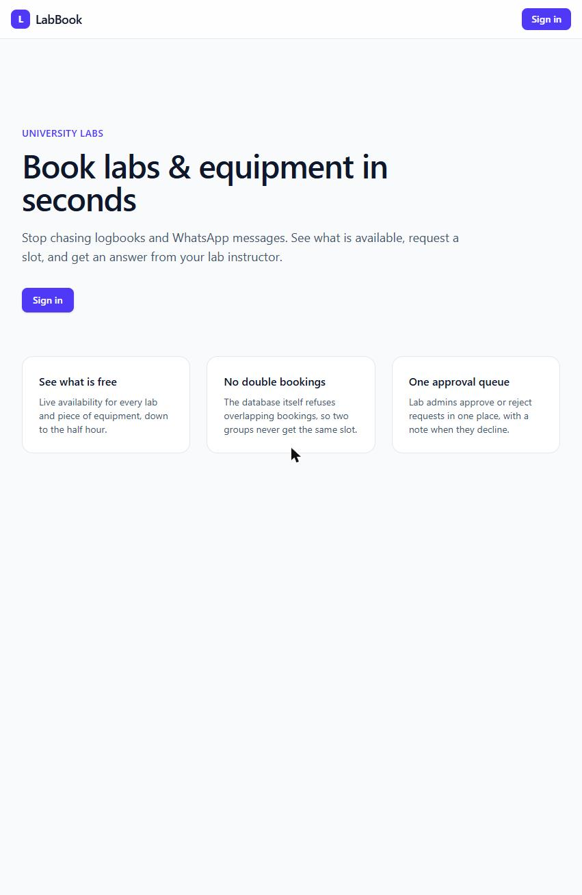
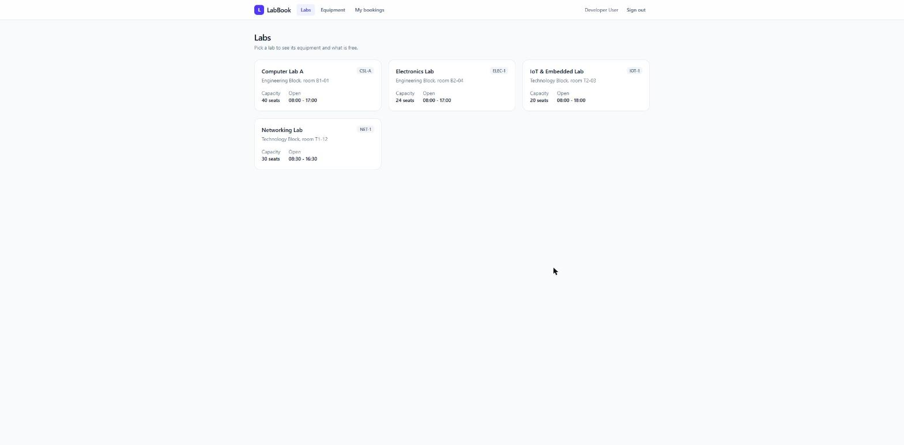
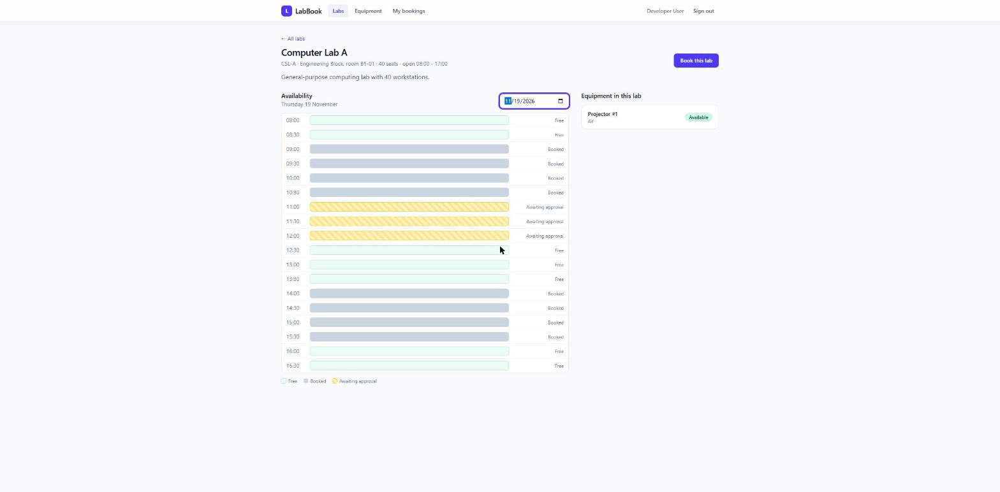
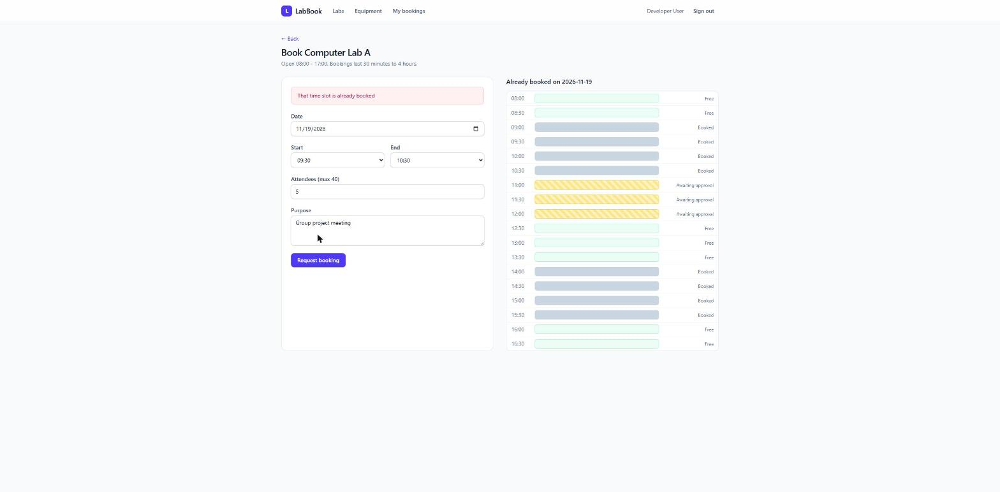
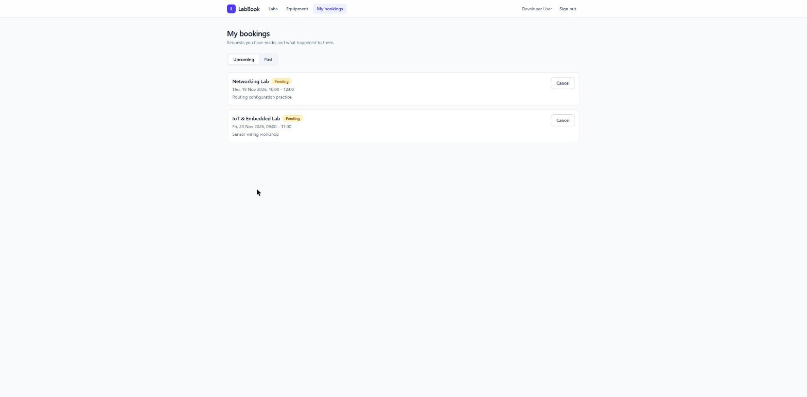
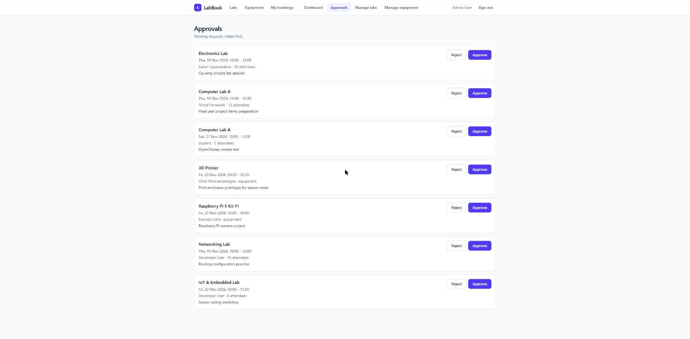
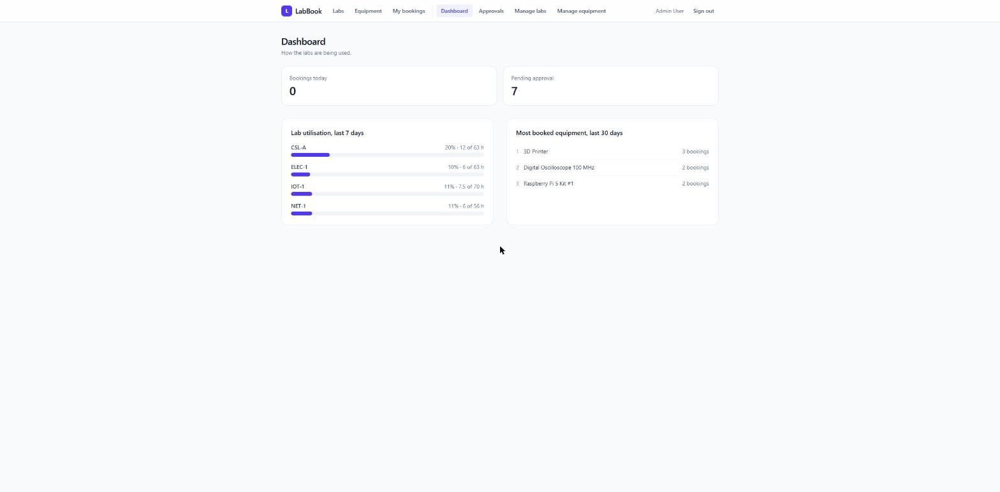

# User guide

## Students

1. **Sign in.** Open LabBook and choose *Sign in*. You are sent to ThunderID to sign in, then return to the labs page.

   
2. **Browse labs.** Each card shows the building, room, capacity and opening hours.

   
3. **Check availability.** Open a lab to see its equipment and a day timeline. Grey blocks are busy, striped blocks are waiting for approval. You can look up to 30 days ahead.

   
4. **Find equipment.** The Equipment page filters by category and status.
5. **Request a booking.** Choose *Book*, pick the date, a start and end time on a 30-minute step, the number of attendees (labs only) and a purpose. Bookings last 30 minutes to 4 hours, must fit inside opening hours and start within 30 days. If something is wrong, the form tells you which rule you broke or that the slot is taken.

   
6. **Track bookings.** *My bookings* has Upcoming and Past tabs with a status on each. You can hold at most 3 upcoming bookings. Cancel an upcoming one with *Cancel*.

   

Statuses: **pending** (waiting for an admin), **approved**, **rejected** (see the admin's note), **cancelled**, **completed**, **expired** (nobody approved it before it started).

## Admins

Admins are the people listed in the `adminEmails` configuration. They can do everything a student can; their own bookings are approved immediately.

1. **Approvals.** The queue shows pending requests, oldest first. *Approve*, or *Reject* with a note of 3 to 300 characters.

   
2. **Labs.** Create, edit and deactivate labs. Inactive labs cannot be booked.
3. **Equipment.** Create and edit items and change their status. Items in `maintenance` or `retired` cannot be booked.
4. **Dashboard.** Bookings today, pending count, lab utilisation over the last 7 days and the most-booked equipment.

   
